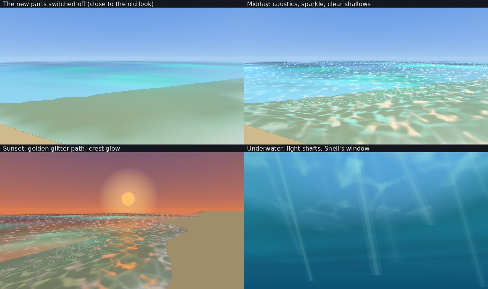

# Water

Everything about the water lives in three places:

- `shared/water_sim.h`: the swell (eight Gerstner waves: sharp crests, wide troughs; the two finest only show on the finest mesh), the ripple
  simulation (`RippleField`, the wave equation on a 64 x 64 grid of 14-unit cells that follows the player), and the textures (all 256 x 256 I8:
  caustics, glints, sparkle and swell bands as 16-frame looping flipbooks; foam, streaks, clouds and the splash-sprite atlas), made at start-up
  on three threads. Tested in `server/tests/water_tests.cpp`.
- `shared/water_look.h`: how a point of the surface is shaded (colour by depth, Fresnel sky reflection, sun and moon glitter path, light through
  the crests, Snell's window from below, foam). The game and the preview renderer use this same function.
- `mod/Royale/features/Water.inc`: drawing it in the Water graphics layer.

`tools/water/preview.cpp` renders the pictures above from the same code: `g++ -O2 -std=c++17 -Ishared tools/water/preview.cpp -o /tmp/wp && /tmp/wp docs/water`
(then convert the .ppm files). It shades the game's grid points and blends between them as the game does, over a plain sandy floor; it is a
preview, not a screenshot.

## What is drawn

All water surfaces get it: the island maps' sea and lakes (Hyrule Kingdom's water at -227 included), the game's own lakes and rivers on other
maps (with a smaller swell, since the game's own water sits just under ours), and puddles (the sky sheen and the sparkle, as a soft oval on each).

1. **Caustics**: a sheet lying on the floor under shallow water (its own 40-unit grid round the camera), drawn first, with the caustics
   flipbook. Bright in the shallows in sun, fading with depth, at night and under cloud. On the old Fortnite island it lies on the drawn sea bed.
2. **The water**: three meshes, one inside the next (a clipmap): squares of 16 units round the player, 64 units out to about 1000 and 256 units out
   to the horizon. Each sits on the world's own grid and leaves a hole where the finer one lies; the finer one's rim is the coarser one's own edge
   (position, colour, everything), blended into its own shape over four squares, so they meet without a crack. Every pass is drawn on every mesh
   it reaches, so nothing drops out round the swimmer (before, a coarse sheet carried the bands and streaks and the small squares near the player
   had none: a hole in them under the swimmer, and creases where coarse met fine). Vertex colour and alpha from `ShadeWater`. The swell on a mesh
   leaves out waves shorter than 2.5 of its squares (they would alias into a patchwork); the finest mesh and the ripple field carry the chop and
   the wake. Where the floor rises to the surface the sheet fades out (the floor's depth test cuts it), so the shore is as crisp as the finest
   mesh. On lakes and rivers the game's own water is still drawn under ours, so there ours is nearly opaque (232 of 255) and hides it.
3. **Swell bands** (High): rolling mid-sized waves, lit on their faces, travelling downwind.
4. **Clouds**: a cloud texture where each cloud's reflection falls (parallax from the camera height), strongest at a slant, golden at dusk, dim and
   cool at night, thicker the more overcast it is (Medium and up).
5. **Sparkle**: the same points again with the glint flipbook; the vertex colour is the sky's (or the sun's on the glitter path) and the vertex
   alpha says how much shows.
6. **Foam**: the same points with the foam texture, on the waterline, in wakes and on crests about to break.
7. **Streaks**: the wind's foam wisps (Medium and up).
8. **Sprites** (`DrawWaterParts`): splash crowns (droplets stretched along their flight, a column of spray puffs, a spreading foam disc), bubbles
   that rise, wobble and break in a ring, spray off the bow, foam on the surface. The game's own water effects (EffectSsGSplash, GRipple, Bubble,
   DtBubble, Sibuki) are caught every frame by `WaterAdoptGameFx` and deleted before they are drawn: beside Link, a bot or a cart they are just
   dropped (`WaterBody` makes the same splash and rings); elsewhere (an arrow, a bomb) a splash or ring of ours takes their place.

Texture passes use the combiner `colour = SHADE, alpha = TEXEL0 x SHADE alpha` with 256 x 256 I8 textures loaded with a tile load. Texture
coordinates count from an origin that moves a whole tile at a time, and scrolls are wrapped to -128..128 texels, so they stay inside the 16-bit
range (about +-1000 texels) and never jump; the textures fade out before the meshes that carry them end for the same reason. The sheet's textures
are about 18 MB on the GPU (every flipbook frame is a texture of 256 KB there).

## Graphics page, Water section

Swell height, wave shape (round to choppy), surface detail, clear water, sparkle (on/off and strength), caustics (on/off and brightness), textured
foam (on/off and amount), ripple simulation, the game's splashes and more water life, displacement, rain rings, sky and body reflections,
underwater look (on/off and strength), current. CVars `Royale.Water*`.

## For creatures and water physics

- `WaterInfoAt(x, z)` gives what the water is like at a point as it is drawn: surface level, height now (swell and ripples), depth, normal, current.
- `AddWaterDisturb(x, z, strength, size)` makes a ring (inside the ripple simulation it pushes the simulation; further off it is an analytic ring).
- `gRipples.Impulse(x, z, depth, radius)` pushes the simulation directly, every frame if something keeps moving (a fin, a tail): it makes a wake.
- `royale::water::Swell(x, z, t, amp, chop)` is the open-water wave itself (height, sideways shift, normal, how near the crest is to breaking).
